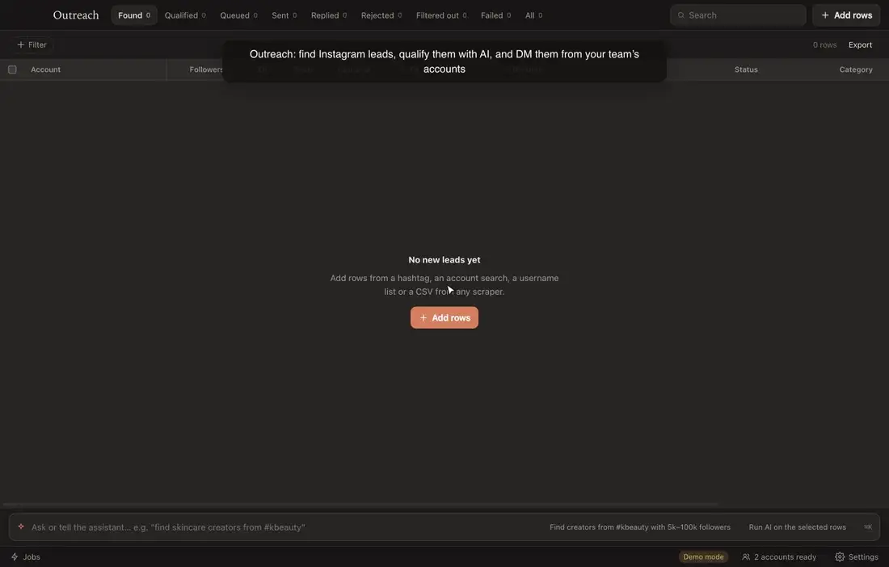
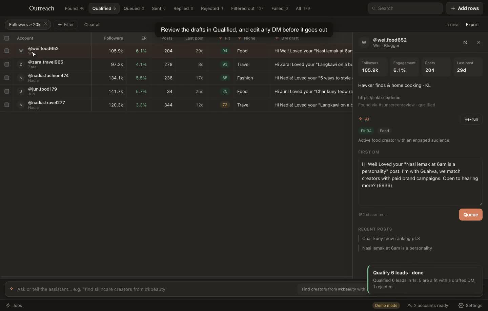

<h1 align="center">Outreach</h1>

<p align="center">Find Instagram leads, qualify them with AI, and DM them from your team's own accounts.</p>

<p align="center">
  
</p>

<p align="center">
  <a href="docs/outreach-explainer.mp4">Watch the 1-minute explainer</a> ·
  <a href="#install">Install</a> ·
  <a href="https://github.com/hormuz-labs/outreach-releases/releases/latest">Latest release</a>
</p>

---

Outreach works like a spreadsheet of leads. **Add rows** from an Instagram hashtag, an account search or any scraper's
CSV. **Run the AI columns** to score each account against your brief and draft a personal first DM. **Queue** the ones
you like, and **send** from your team's Instagram accounts within safe daily limits. Scrapes, AI runs and sending
continue in the background, and you get a notification when each one finishes.

Prefer typing? The command bar (<kbd>⌘</kbd> <kbd>K</kbd>) takes plain requests, such as *"find skincare creators from
#kbeauty with 5k to 100k followers"* or *"queue these and start sending"*. It knows which rows you've selected.

<p align="center">
  
</p>

## Install

```bash
brew install hormuz-labs/tap/outreach     # macOS
```

On Debian or Ubuntu, add the signed apt repository once and apt keeps Outreach up to date:

```bash
curl -fsSL https://apt.guahva.com/outreach.gpg | sudo gpg --batch --yes --dearmor -o /usr/share/keyrings/outreach.gpg &&
echo "deb [signed-by=/usr/share/keyrings/outreach.gpg] https://apt.guahva.com stable main" | sudo tee /etc/apt/sources.list.d/outreach.list &&
sudo apt update && sudo apt install outreach
```

Other Linux: the AppImage from the [latest release](https://github.com/hormuz-labs/outreach-releases/releases/latest).

Open Outreach and add a Gemini API key in **Settings**, or turn on **Demo mode** there to try every step with fake data.

This repository holds only the installers, built by CI from each version of the app.
